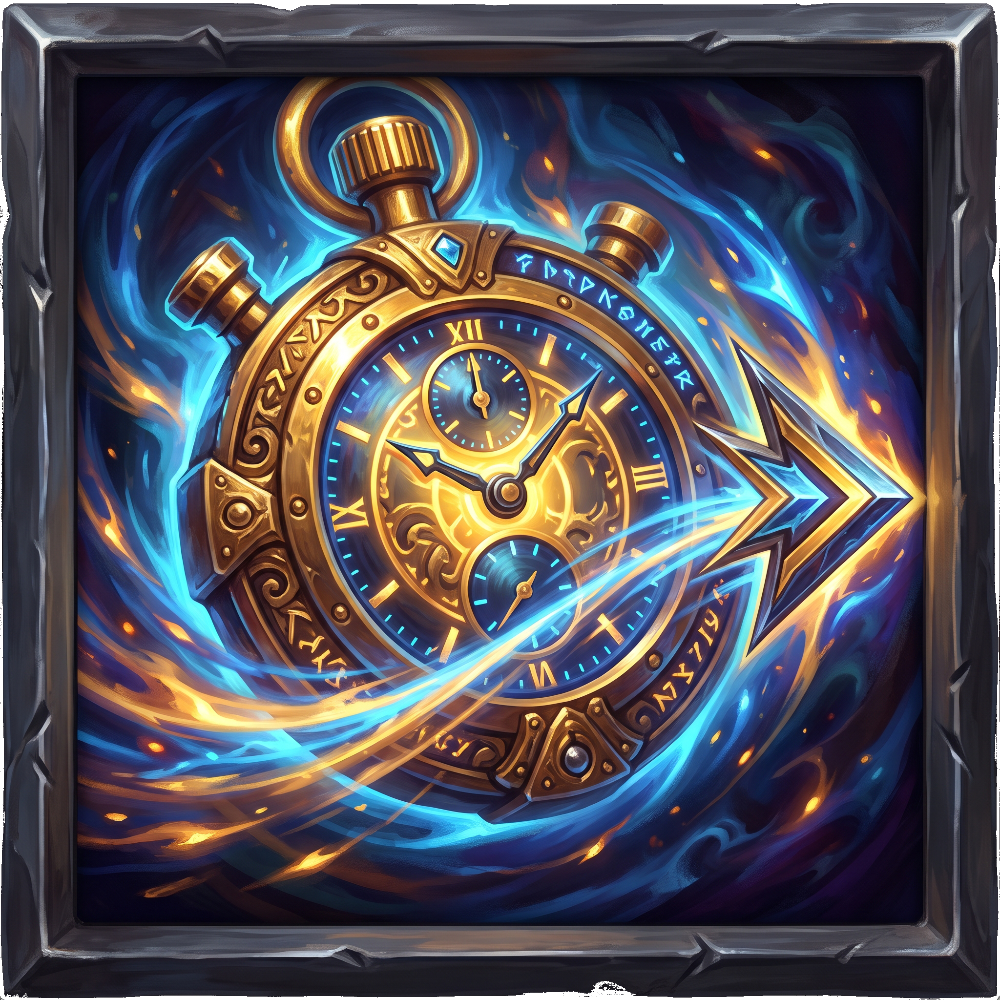

# Velocity Split Tracker

Speedrunning adapted for the open-world chaos of World of Warcraft. Velocity turns every alt
into a live time-trial, with clean LiveSplit-style feedback against your own best runs or an
imported community record. No two WoW runs follow the same script, so instead of rigid split
files and intrusive quest guides it is an **ambient flight recorder and ghost-car pacer**: it
records every leveling run in the background and projects the shape of your reference route
onto a compact HUD, so you can judge your pace and decide on the fly whether to push, grind,
or pivot.

Target client: WoW Forever (`_forever_`, interface 16001, Mainline UI code).
Folder / TOC: `VelocitySplitTracker`. SavedVariables: `VelocitySplitTrackerDB`
(data from the earlier `SplitTimer` name is migrated automatically on first load).

## Key features

- **Dual-clock timing: Active and `/played`.** Both are tracked. The Active clock stops after
  30 s with no movement, casting, combat or NPC interaction - step away and the idle time is
  not counted - which makes speed-leveling practical across normal multi-session play.
  `/played` is kept alongside for the purist comparison. (Idle detection is activity-based,
  not window-focus-based.)
- **Zero-config auto-recording.** Install it and play. Every character is logged and indexed
  by start zone, class, level and an optional named routing pattern. No split files to edit.
- **LiveSplit-style pace HUD.** Real-time split deltas (`+/-`), previous-segment comparison,
  gold for a true record, progress bars for the next level, profession step and money
  milestone. Compact single-row timer by default; a large LiveSplit-style timer is an option.
- **Route horizon.** Upcoming level splits, sub-zone entries and milestone timestamps from
  your reference run, so the macro route ahead is visible at a glance. (Today: the next
  anchors. A multi-anchor horizon and fork display are on the roadmap - see `SPEC.md` 5.8.)
- **Bottleneck reminders.** Profession rows show the trainable threshold and the untrainable
  stretch above the current cap in red, and stay on screen while a tier is waiting to be
  trained - so you never leave a town hub having forgotten the trainer. Money-acquired
  milestones (1s, 10s, 1g, 10g, ...) are tracked the same way.
- **Flexible cross-benchmarking.** Race your fastest run in that start zone (**Auto select**:
  the run fastest to its own end among those still ahead of you, handing off to a longer run
  when you pass the short one's end), a pinned run, a *Best splits* amalgam of the fastest
  time per milestone, or nothing at all. Filter candidates by start zone, class and pattern -
  or compare across them, e.g. a Skyborne mage against a dwarf hunter's record.
- **Share and import.** Name routing patterns, copy a run summary as text, and import
  reference splits (level times from a VOD or another player) to race against.
- **Deaths and detours recorded.** Death splits with rez type, area entries, first-learn of
  professions, and user-placed location splits all land in the same timeline with
  coordinates, so a post-run review can see where the time went.

## Commands

| Command | Action |
|---|---|
| `/split` or `/velocity` | Toggle the split window |
| `/split history` | Data window (By Level / By Class / By Start Zone / History) |
| `/split import` | Import a reference run (paste level times) |
| `/split config` | Settings |
| `/split pause` / `resume` | Pause / resume the Active clock |
| `/split clock active|played` | Which clock the window and comparisons use |
| `/split mode <pve|pvp|hardcore-pve|hardcore-pvp|auto>` | Game mode carried on the run record |
| `/split lock` / `reset` | Lock dragging / reset window position |
| `/split wipe` | Discard this character's record and start fresh |
| `/split status`, `ms`, `rows`, `skills`, `cpu` | Diagnostics |

Minimap button: left-click window, right-click data window, middle-click settings.
The hamburger (top-left of the split window) opens the menu: add/remove location splits,
pause the clock, display toggles, History, Import, Settings.

## What it is not

Not a quest guide. It will not tell you where to go next or draw waypoint arrows; it tells
you how your pace compares to the run you chose to race, and leaves the route to you. Not
a world-first tool either: those runs need a never-leave-the-chair discipline that no idle
detection replaces. This is for the other 99 % of leveling.

See `SPEC.md` for the design, `CHANGELOG.md` for what has shipped.